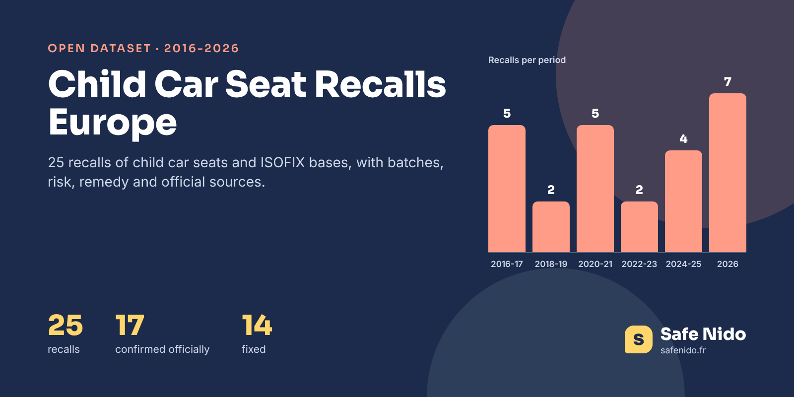

# Child Car Seat Recalls Europe 2016-2026



[](https://doi.org/10.5281/zenodo.24154463) [](https://www.kaggle.com/datasets/safenido/child-car-seat-recalls-europe) [](https://huggingface.co/datasets/safenido/child-car-seat-recalls-europe) [](https://creativecommons.org/licenses/by/4.0/) [](https://www.safenido.fr/)

**English first, version française plus bas.**

Child car seats are recalled more often than parents think, and the notices are scattered across national portals, brand help pages and the German press. This dataset gathers **25 recalls and safety notices** for child car seats and ISOFIX bases sold in Europe between 2016 and October 2026, with the batches concerned, the risk, what to do, whether the problem is fixed, and the official page behind each one.

### The Headline Numbers

|  |  |
|---|---|
| Recalls and safety notices | 25 |
| Period | March 2016 to October 2026 |
| Confirmed on an official page | 17 |
| Fixed | 14 |
| Still ongoing | 4 |
| Most recalls | Recaro and Britax Römer, 4 each |

Most recalls touch one part, a harness buckle, a carrying handle or a base latch, and only some production batches. That is why the batch and serial columns matter more than the model name. A parent who owns the model is often not concerned, but has to check the label to be sure.

### Files

| file | content |
|---|---|
| `data/child_car_seat_recalls_europe.csv` | 25 rows, one per recall |
| `images/cover.png` | Cover image, 1600 × 800 |

### Columns

**child_car_seat_recalls_europe.csv**

| column | description |
|---|---|
| `recall_id` | Safe Nido identifier |
| `announced, recall_end` | Dates (YYYY-MM-DD) |
| `brand, product_as_named` | Brand and product as named in the notice |
| `component_fr` | Part concerned (French) |
| `countries` | Countries named in the notice |
| `batches_or_serials, production_dates, sale_period` | Scope of the recall |
| `risk_fr, remedy_fr` | Risk and what to do (French) |
| `status` | fixed, ongoing or unknown |
| `confidence` | official (read on an official page) or press |
| `source_urls` | Pages read |
| `safenido_urls` | Seat pages on Safe Nido |

### Load It

```python
import pandas as pd

base = "https://raw.githubusercontent.com/safenido/child-car-seat-recalls-europe/main"
df = pd.read_csv(f"{base}/data/child_car_seat_recalls_europe.csv", parse_dates=["announced"])
df.sort_values("announced", ascending=False)[["announced", "brand", "product_as_named", "status"]]
```

### How It Was Built

Collected on 30 September 2026 and updated in October 2026 from RappelConso (searched by category and keyword), brand safety pages, the UK OPSS, ÖAMTC and the German site produktwarnung.eu, then each notice was read on its source page. Texts are rewritten in plain French by Safe Nido, never copied.

### Checked Against The Source

Every row has at least one source URL. Rows marked official were read on RappelConso, the brand site, the distributor running the recall or a public authority.

### Read With Care

- **Not exhaustive before 2021**, when RappelConso started. Older recalls depend on what the press relayed.
- **Recalls outside Europe are left out** (United States, Canada).
- **Warnings after a failed crash test are not recalls** and are not listed here.

### License And Citation

**[CC BY 4.0](https://creativecommons.org/licenses/by/4.0/)**. Use it, share it and adapt it, commercially or not, and credit **Safe Nido** with a link to **[safenido.fr](https://www.safenido.fr/)**, along with the original source below.

```bibtex
@misc{safenido_child_car_seat_recalls_europe_2026,
  title  = {Child Car Seat Recalls Europe 2016-2026},
  author = {{Safe Nido}},
  year   = {2026},
  doi    = {10.5281/zenodo.24154463},
  url    = {https://github.com/safenido/child-car-seat-recalls-europe},
  note   = {Dataset, version 1.0}
}
```

Source. RappelConso (France), brand safety notices, OPSS (UK), ÖAMTC and press, compiled by Safe Nido, https://rappel.conso.gouv.fr/

Archived on **[Zenodo](https://doi.org/10.5281/zenodo.24154463)** with a permanent DOI, 10.5281/zenodo.24154463.

Companion datasets, **[Child Car Seat Specifications Europe](https://github.com/safenido/child-car-seat-specs)** ([Kaggle](https://www.kaggle.com/datasets/safenido/child-car-seat-specs), [Hugging Face](https://huggingface.co/datasets/safenido/child-car-seat-specs)), **[Child Car Seat Crash Test Statistics 2007-2026](https://github.com/safenido/child-car-seat-crash-test-statistics)** ([Kaggle](https://www.kaggle.com/datasets/safenido/child-car-seat-crash-test-statistics), [Hugging Face](https://huggingface.co/datasets/safenido/child-car-seat-crash-test-statistics)). All Safe Nido datasets are listed in **[Child Passenger Safety Datasets](https://github.com/safenido/child-passenger-safety-datasets)**.

Also on **[GitHub](https://github.com/safenido/child-car-seat-recalls-europe)**, **[Kaggle](https://www.kaggle.com/datasets/safenido/child-car-seat-recalls-europe)** with a starter notebook, and **[Hugging Face](https://huggingface.co/datasets/safenido/child-car-seat-recalls-europe)**, ready for the `datasets` library.

### On Safe Nido

The data behind these files is used on [Safe Nido](https://www.safenido.fr/), an independent French guide to child car seats built on twenty years of crash tests.

- [Child car seat recalls, kept up to date](https://www.safenido.fr/guides/rappels-sieges-auto/)
- [Seats to avoid](https://www.safenido.fr/sieges-auto-a-eviter/)
- [Buying a second hand seat](https://www.safenido.fr/guides/siege-auto-occasion/)

---

## Version Française

### Les Rappels De Sièges Auto En Europe, 2016-2026

25 rappels et avis de sécurité sur des sièges auto et des bases ISOFIX vendus en Europe, avec les lots concernés, le risque, la marche à suivre, l'état de la correction et la source officielle de chacun. La liste tenue à jour est sur Safe Nido.

Licence CC BY 4.0, en citant **Safe Nido** et un lien vers **[safenido.fr](https://www.safenido.fr/)**. Retrouvez les guides et les fiches des sièges sur [Safe Nido](https://www.safenido.fr/).
